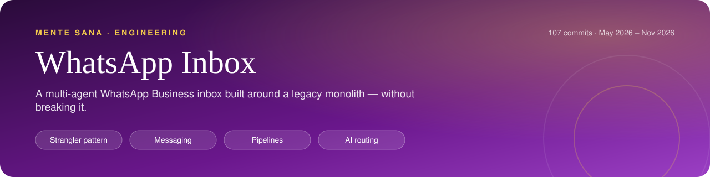
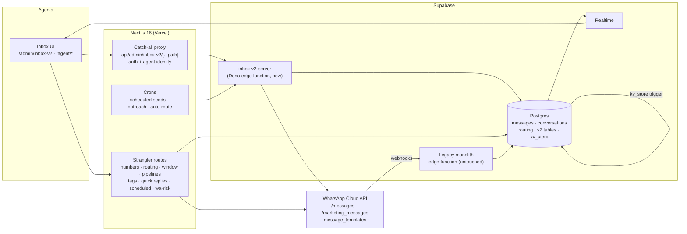

     

<h1 align="center">inbox-v2 — a multi-agent WhatsApp Business inbox, built around a legacy monolith without touching it</h1>
<!-- /header -->

## Latest (Nov 2026)

**A send guard for bulk template campaigns** — `src/lib/wa-send-guard.ts` (+ tests). After Meta banned our sending numbers for marketing volume, I found the quality monitor only throttled the legacy monolith while the new scheduler kept sending with numbers in YELLOW/RED. Every bulk batch now passes three checks before it reaches Meta: the number must be GREEN and not paused, a per-number daily cap (overflow is postponed to 10:00 Madrid next day, DST-aware) and opted-out phones are stripped. Lesson written into code: a quality signal nobody enforces is just a dashboard.

A production CRM inbox where sales and support agents work every WhatsApp conversation of an online psychology clinic from one place: multiple numbers, routing, pipelines, templates, scheduled sends and automated outreach. Built incrementally with a strangler-fig pattern so the legacy system kept running the whole time.

> Extracted from the private monorepo of **Mente Sana**, an online psychology clinic in Spain (8,000+ patients, 150+ licensed psychologists). 108 commits of real history, May–Nov 2026. Author: Alejandro Álvarez (CTO).

---

## At a glance

<table>
  <tr>
    <td align="center" width="25%"><b>Strangler-fig over a live monolith</b> Pattern</td>
    <td align="center" width="25%"><b>Multiple WhatsApp numbers</b> Channels</td>
    <td align="center" width="25%"><b>Routing, pipelines, templates, schedules</b> Workflow</td>
    <td align="center" width="25%"><b>Auto-routing &amp; lead scoring</b> AI</td>
  </tr>
</table>

## The problem

All patient and lead communication runs over WhatsApp, spread across several business numbers and WhatsApp Business Accounts (WABAs). The existing tooling was a single large Supabase edge function (the "monolith") that received Meta webhooks, stored messages and kept its config in a key-value table. It worked, but:

- Agents could not see who had sent what, which number a lead had written to, or why a send failed.
- Replying from a different number than the one the lead wrote to breaks Meta's 24-hour customer-service window.
- There was no notion of sales vs support, pipelines, assignment, or follow-up.
- Bulk MARKETING templates through the classic Cloud API carry a high ban risk; the clinic had already lost a WABA.
- Rewriting the monolith was not an option: it processes every inbound webhook in production.

## What I built

| Area | What it does |
|---|---|
| **Inbox UI** (`/admin/inbox-v2`) | Responsive 1/2/3-column layout (list · chat · insights), mobile tabs, infinite scroll in both list and thread, filters (unread, expiring, closed, mine, sales/support, last-message date range), emoji picker, quick replies with `/`, inline profile editing. |
| **Realtime** | Supabase Realtime on messages and conversations, with a polling fallback (4 s visible tab, 15 s hidden) because the WebSocket does not always attach on cold starts. Late responses from a previously open conversation are discarded. |
| **Multiple numbers + routing** | CRUD for WhatsApp numbers; every conversation remembers the number the lead wrote to (`conversation_routing`) and the agent always replies from it. Manual reassignment from the chat header. |
| **24 h window** | SQL function `conversation_window_info` (open / expiring_soon / expired / never_inbound), `WindowBadge` in the chat, and an `/expiring` view of conversations about to close. |
| **Send text, media, templates** | Media upload to Supabase Storage, template picker filtered to APPROVED templates of the selected number's WABA, live preview with `{{n}}` variables and header media, single and bulk sends with per-recipient parameters. |
| **Failure visibility** | Failed sends are persisted with `status='failed'` and Meta's raw error; the chat renders a red bubble with a human explanation and a suggested fix (window closed → send a template, token expired, invalid number, rate limit, etc.). |
| **Pipelines** | Kanban per template family with drag-and-drop, assign and move; moving a card to a higher phase triggers the matching template send. |
| **Tags, quick replies, scheduled templates** | CRUD endpoints and UI; scheduled sends are stored and dispatched by a cron, with Europe/Madrid times parsed server-side independent of the browser. |
| **Template builder** (`/admin/inbox-v2/templates`) | Create WhatsApp templates with Meta's rules enforced live (name normalisation, limits, consecutive variables with examples, ≤3 buttons, banned words), WhatsApp-style preview, submit for review, translated rejection reasons. |
| **Automated outreach** (`src/lib/wa-outreach.ts`) | Rule-driven template campaigns sharing rules and cooldowns with the in-app chat channel; template-version rotation, per-number daily caps, staggered batches, exclusions. |
| **Number health** | `/health` (inbound/outbound per number, last received), `/numbers`, and a `wa-risk` endpoint that scores each number on quality rating, 24 h template volume, per-template read rate and spammy template content. |
| **Agent tools** | Amelia (booking system) tab to view packages and book/reschedule/cancel sessions from the chat; Upsells tab showing what the lead already bought and what to offer, with "already offered" checks. |

### AI features (documented in the history; most code lives outside this extract)

- **Auto-routing sales vs support** — a 3-layer cascade: hard signals from the booking system (active package or upcoming appointment → support) → lexical keyword sets → Claude Haiku only for ambiguous cases, returning `{client_type, confidence, reason}`; heuristic fallback if the model fails. Writes are guarded with `client_type IS NULL` so a manual decision is never overwritten, and every decision is logged as an auditable event. Runs per conversation (with `?dry=1`) and as a cron.
- **Predictive lead score (0–100, HOT/WARM/COLD/FROZEN)** — embeds a conversation summary with Voyage (`voyage-3-large`), compares similarity against historical paid vs lost conversations, applies explicit boosts/penalties, and asks Claude Haiku for a two-sentence explanation. UI: `LeadScoreBadge.tsx`.
- **AI-suggested emails** — Claude Haiku drafts a structured JSON email from conversation insights and an agent-chosen intent; every field is editable with a live sandboxed-iframe preview before sending. UI: `EmailSuggestModal.tsx`.
- **In the edge function itself:** semantic search over conversations, conversation summaries, suggested replies and risk flags (Voyage embeddings + streamed Claude responses).

---

## Architecture

- **Inbound** stays on the legacy monolith (Meta webhooks → messages tables).
- **Outbound and everything new** goes through `inbox-v2-server` or Next.js route handlers that read/write Postgres directly.
- **Shared state** is bridged both ways: a DB trigger copies the monolith's per-conversation number from `kv_store` into `conversation_routing`; v2 writes mirror back into `kv_store` in the exact JSON shape the monolith expects.

---

## Key decisions & trade-offs

**Strangler fig instead of a rewrite.** The monolith keeps receiving webhooks; inbox-v2 adds new tables, a new edge function and Next.js routes alongside it. Realtime was enabled on the existing tables via a migration, without changing monolith code. Trade-off: two sources of truth for number config, handled with explicit sync (below) rather than avoided.

**Bidirectional sync with the legacy KV store.** Creating, editing or deleting a number writes to `whatsapp_numbers` *and* upserts every matching `kv_store` entry (the monolith had many duplicate entries per number). Routing works the same way: an `AFTER INSERT/UPDATE` trigger on `kv_store` propagates routing to `conversation_routing` idempotently (only when the value changes), and manual reassignment upserts both.

**Reply from the number the lead wrote to.** Every send resolves the conversation's routed number first, falling back to the default. This removes a whole class of Meta errors around the 24 h window and keeps threads coherent. The UI shows which number is in use and warns when a conversation has no routing.

**Treat the 24 h window as data, not a surprise.** Window state is computed in SQL from the last inbound message and surfaced before the agent types; when a free-text send still fails, the error is translated into "send an approved template to reopen".

**Never lose a failed send.** Failures are inserted as messages with `status='failed'` and Meta's literal error, so agents and admins see what happened in the thread instead of a transient 502. The client also re-fetches shortly after sending because Meta can accept a POST and fail it asynchronously.

**Route MARKETING templates through MM Lite, fail safe to Cloud API.** The edge function looks up the template category (cached per process) and sends MARKETING to `/marketing_messages`, everything else to `/messages`. Unknown category → classic route. If a number is not enrolled in MM Lite (Meta error 133010), it falls back to `/messages` instead of failing every send.

**Idempotent pipeline moves.** Moving a kanban card to a higher phase sends that phase's template once; moving back only moves visually; terminal states (responded / won / lost) never send. A `dry_run` flag lets the UI preview the effect.

**Auth and attribution at the proxy.** The browser never holds the edge-function secret. A Next.js catch-all route checks the admin session, adds the secret, and injects the real agent id/name into send and broadcast bodies so every message shows who sent it. Multipart uploads are streamed through untouched.

**Template caches scoped per WABA.** Two WABAs can have approved templates with the same name. A global `{name → body}` cache rendered the wrong body in history; it is now keyed by phone number id, preferring the conversation's assigned number.

**Outreach that protects the numbers.** Automated sends rotate to the least-used approved template version in the last 7 days, skip non-approved or RED-quality templates, cap daily volume per number, prefer the conversation's routed number, honour a cross-channel cooldown with the in-app chat, exclude recipients who blocked or were throttled by Meta, and are *scheduled* (cancellable) rather than sent immediately, optionally staggered in batches.

**Explicit timezone handling.** All times render in Europe/Madrid regardless of the agent's browser, and scheduled-send times are parsed server-side independently of the server's timezone, with a clear error instead of a silent non-send.

---

## Code tour

| Path | What to look at |
|---|---|
| `supabase/functions/inbox-v2-server/index.ts` | Deno edge function: routed sends (text/template), MM Lite routing + fallback, failed-send persistence, concurrent bulk broadcast with per-recipient components, Meta template catalogue across WABAs, semantic search, summaries, suggested replies. |
| `src/app/api/admin/inbox-v2/[...path]/route.ts` | Authenticated proxy to the edge function with agent attribution. |
| `src/app/api/admin/inbox-v2/numbers/` | Number CRUD with mirroring into the legacy KV store. |
| `src/app/api/admin/inbox-v2/conversations/[id]/` | `assign-number` (routing upsert + KV mirror), `window` (24 h state RPC), `send-media` (Storage upload + send). |
| `src/app/api/admin/inbox-v2/pipelines/` | Families, cards, `assign`, idempotent `move`. |
| `src/app/api/admin/inbox-v2/scheduled-templates/` · `tags-crud/` · `quick-replies-crud/` | CRUD for scheduled sends, tags and quick replies. |
| `src/app/api/admin/inbox-v2/health/wa-risk/route.ts` · `health-extended/` | Per-number ban-risk scoring and inbox health. |
| `src/app/admin/inbox-v2/_components/ChatPanel.tsx` | Thread, composer, failure explanations, realtime + polling, stale-response guard. |
| `src/app/admin/inbox-v2/_components/ConversationList.tsx` | Filters, infinite scroll, in-place merge on refresh. |
| `src/app/admin/inbox-v2/_components/TemplatesModal.tsx` · `TemplateCreator.tsx` | Template picker/preview/bulk send and in-modal template creation. |
| `src/app/admin/inbox-v2/_components/AmeliaToolsTab.tsx` · `UpsellsTab.tsx` | Booking-system and upsell tools inside the chat. |
| `src/app/admin/inbox-v2/_hooks/useInboxRealtime.ts` | Supabase Realtime subscriptions. |
| `src/lib/wa-template-builder.ts` | Pure validation and Meta payload builder for new templates. |
| `src/lib/wa-outreach.ts` | Outreach planner and runner (template rotation, number choice, scheduling). |

## Testing

Unit tests (Vitest) cover the pure logic that is easiest to get wrong against Meta's rules:

- `src/lib/wa-template-builder.test.ts` — name normalisation, validation (examples per variable, consecutive variables, banned words, header/footer/button limits, warning when the body ends in a variable), component/payload building, preview filling and Meta error translation.
- `src/lib/wa-outreach.test.ts` — template rotation (least-used version, filtering out non-approved / inactive / RED / unsupported templates, step- and remaining-session-specific versions) and component building with first-name fallback.

Route handlers and UI were verified against production data; they are not covered by automated tests in this extract.

## Stack

Next.js 16 (App Router, route handlers) · React · TypeScript · Supabase (Postgres, Edge Functions on Deno, Realtime, Storage, RPCs/triggers) · WhatsApp Cloud API / Graph API (incl. MM Lite) · Anthropic Claude (Haiku/Sonnet) · Voyage AI embeddings · Vitest · Vercel (hosting + crons)

## About this repo

This is a **read-only extract** of the inbox-v2 subsystem from a private production monorepo, with its real git history preserved. Secrets, tokens and personal data have been removed or replaced with placeholders.

It is **not runnable on its own**: it depends on shared modules from the rest of the monorepo (auth, booking-system access, outreach base rules, email, AI helpers), on database migrations not included here, and on the legacy Supabase edge-function monolith that still handles inbound webhooks. Some commit messages are in Spanish and reference files that were not part of the extract. The goal is to show how the system was designed, evolved and hardened in production, not to provide a drop-in package.
